<p align="center">
  <picture>
    <source media="(prefers-color-scheme: dark)" srcset="assets/logo-dark.svg">
    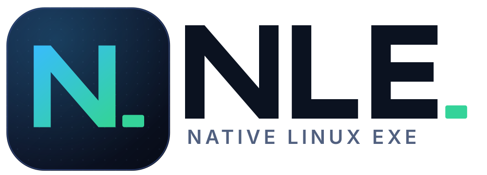
  </picture>
</p>

<p align="center">
  <a href="https://github.com/SegMind25/NLE/actions/workflows/ci.yml"></a>
  
  
  
</p>

# NLE: Native Linux Exe

Run Windows `.exe` programs as **native Linux programs**. No emulator, no virtual machine, no Wine in the loop.

NLE loads the program's machine code straight into a Linux process and answers its Windows API calls with a Rust
reimplementation of the Windows libraries. The CPU runs the program's own instructions at full speed. It can also
**relink** an `.exe` into a standalone Linux ELF file that the kernel starts like any other program.

```console
$ nle app.exe --its --args             # run it
$ nle relink app.exe -o app-linux      # or convert it...
$ ./app-linux/app --its --args         # ...and run it as a Linux program
```

<p align="center">
  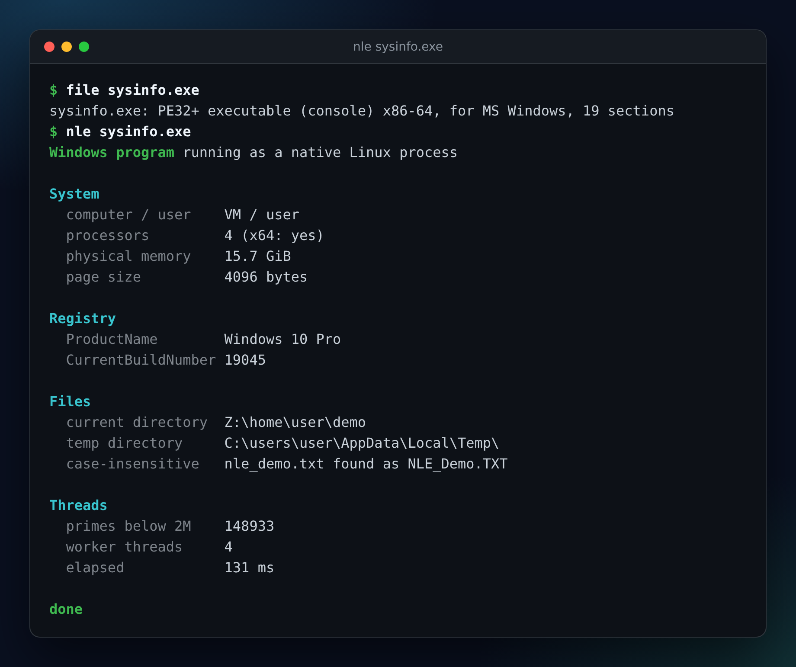
</p>

The idea of converting an executable into the host's native format, with the foreign system's library calls served by a
linked-in reimplementation instead of an emulator, comes from [AnyPS5](https://github.com/boykopovar/AnyPS5), which does
it for PlayStation 5 executables. NLE applies the same idea to Windows x64 executables. It shares no code with it:
that project is GPL-2.0, this one is MIT, and everything here was written from the public PE/COFF, ELF and Win32
documentation.

## What to expect

NLE is a **compatibility layer for x86-64 Windows programs**: console tools, and programs with simple windows. It is honest about its limits:

| works today (tested on every commit) | does not work |
| --- | --- |
| C and C++ programs built with MinGW-w64 (static or dynamic runtime) | **Direct3D**, OpenGL, DirectDraw, GDI+, printing |
| Rust (`x86_64-pc-windows-gnu`) and Go (`GOOS=windows`) programs, which bring their own runtimes | rich edit, MDI, the common file / colour / font dialogs, drag and drop, ActiveX / OLE |
| **programs with windows**: Win32 windows and messages, GDI drawing and text, buttons, check boxes, radio buttons, text boxes, list boxes, combo boxes, scroll bars, **menus and accelerators**, **dialog boxes from resources**, icons / bitmaps / strings from the executable, message boxes, timers (shown on an X11 display, see [docs/GUI.md](docs/GUI.md)) | **32-bit** programs and **.NET** programs |
| the **common controls** (`comctl32`): tool bar, status bar, tab control, list view, tree view, progress / track / spin controls, image lists, `TaskDialog` | visual styles and theme manifests (controls draw in NLE's own classic-modern look) |
| threads, locks, TLS, fiber-local storage, timers | MSVC C++ exceptions (`_CxxThrowException`); MinGW exceptions work |
| files, directories, case-insensitive paths, `C:\` drives, pipes, console I/O | overlapped / IOCP networking (blocking and non-blocking sockets work) |
| structured exceptions, hardware faults (access violation, divide by zero), C++ exceptions, `setjmp` / `longjmp` | anything that needs Windows kernel drivers, DRM, anti-cheat |
| DLL loading (`LoadLibrary`, import DLLs next to the program, `DllMain`, TLS callbacks) | ARM64 hosts (x86-64 Linux only) |
| Winsock sockets, `select`, name resolution | registry hive files, Windows services, COM objects |
| the registry: a persistent hive under the prefix (shared with child processes), seeded with the usual Windows version keys | running as a sandbox: the program has your user's rights |
| starting child processes (Windows children through `nle`, Linux programs directly, drive-path arguments translated for Linux ones), job objects |  |
| Unicode, UTF-8 code page, wide-character APIs |  |

A program is not guaranteed to work because it appears in the left column; real programs use hundreds of APIs. Use
`nle inspect` first: it tells you which of the program's imports are implemented and gives a verdict. Whatever is
missing is named when (and only when) the program actually calls it, and `--strict` refuses to start instead.

When the verdict is *partial* and [Wine](https://www.winehq.org/) is installed, `nle run` hands the program to Wine
(`--backend native` forces the native layer, `--backend wine` forces Wine).

## See it work

Every picture below is real output: [`tools/screenshots.py`](tools/screenshots.py) runs the commands in a terminal
and draws what they print.

| | |
| --- | --- |
| **Check a program first.** `nle inspect` lists the imports and says whether the program can run natively.<br>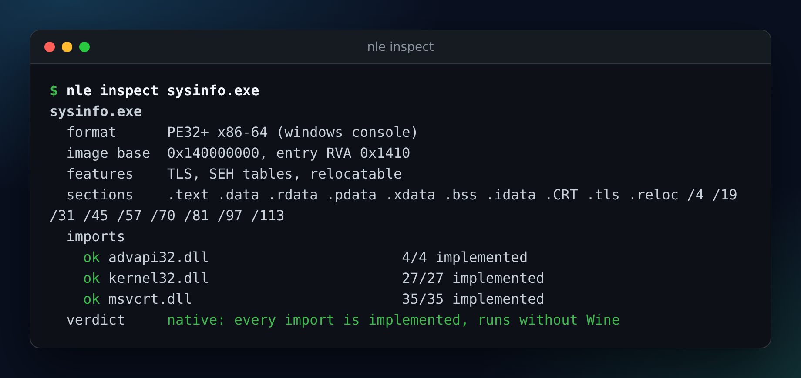 | **Convert it.** `nle relink` writes a Linux ELF; `file` and `ldd` show an ordinary dynamically linked program.<br>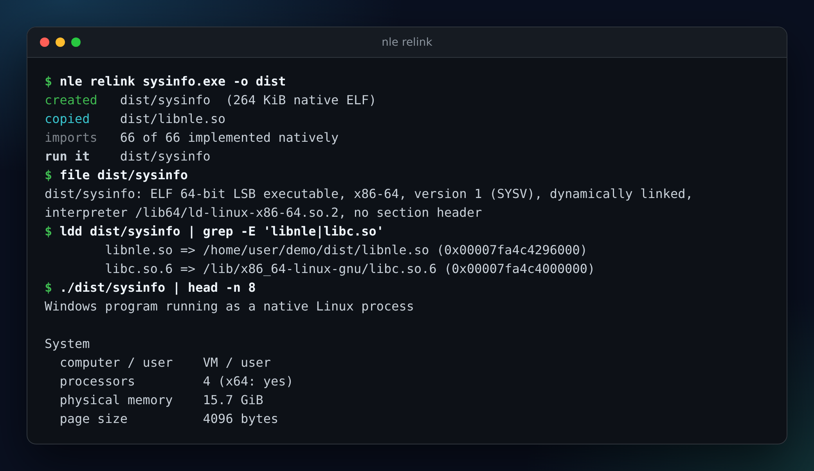 |
| **Go and Rust programs** bring their own runtimes and run unchanged.<br>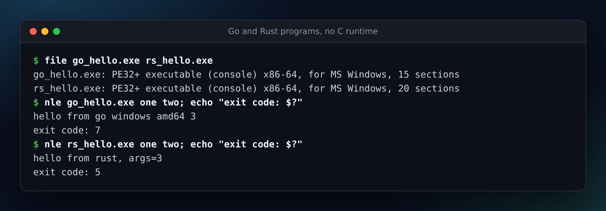 | **Honest limits.** A program that needs OpenGL is reported as partial and stops with a clear message that names the missing function.<br>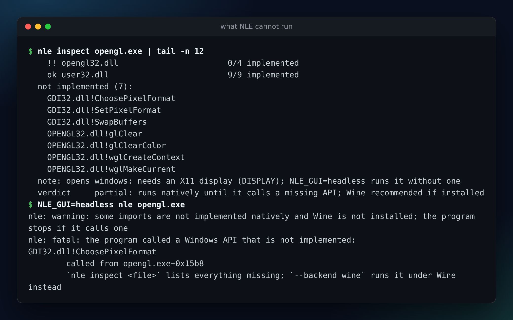 |
| **Real test programs**: threads, files, exceptions, DLLs, sockets, child processes, the registry.<br>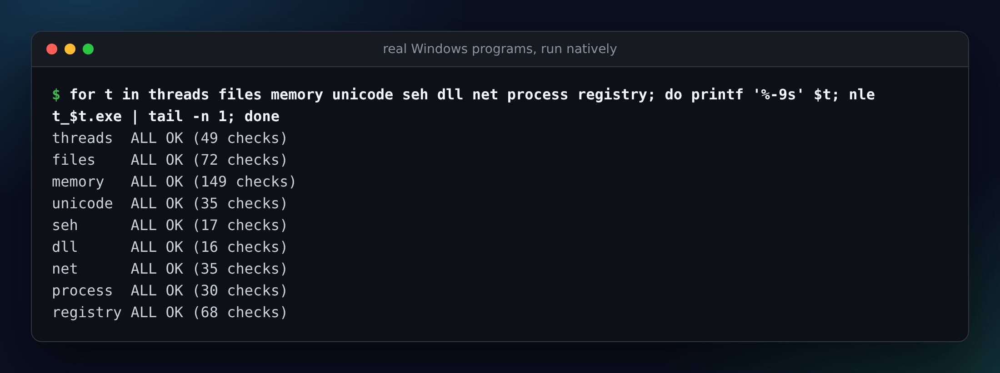 | **Check your machine** with `nle doctor`, and list the 1,850+ implemented functions with `nle coverage`.<br>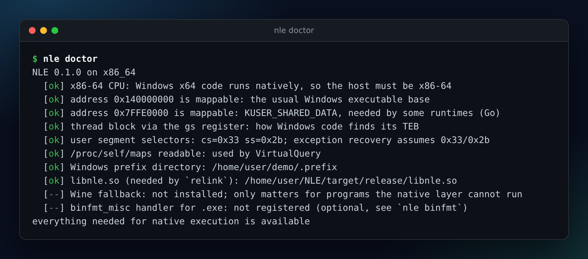 |
| **Programs with windows** run on an X11 display. A form with text box, check box, radio buttons and a timer:<br>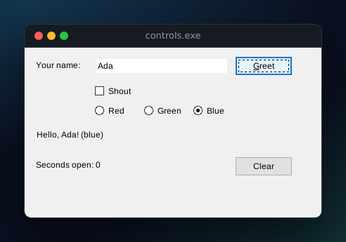 | Freehand drawing with GDI: a back buffer, mouse input, keyboard shortcuts, a timer-driven ball:<br>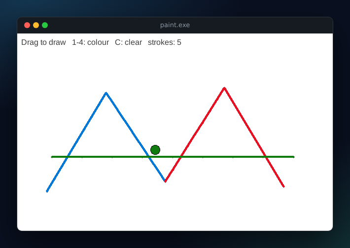 |
| Message boxes with icons, buttons and keyboard handling, from a console program:<br>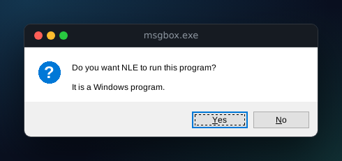 | A plain Win32 window: the program that started this feature.<br>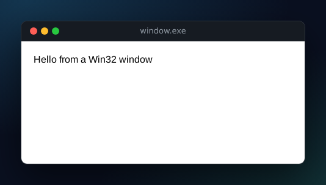 |
| **Menus** with check marks, sub menus, mnemonics and accelerators:<br>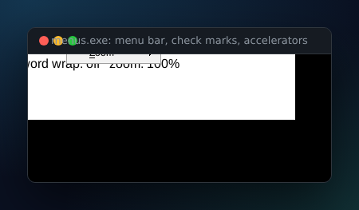 | **Dialog boxes** built from the program's own resources, with Tab / arrow navigation and mnemonics:<br>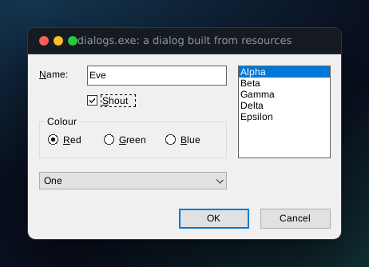 |
| **List boxes and combo boxes**, with drop-down lists and scroll bars:<br>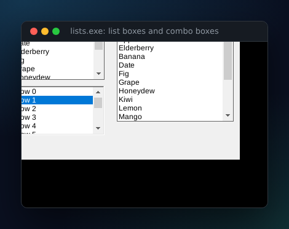 | **Window scroll bars** with thumb dragging, paging and auto-repeat:<br>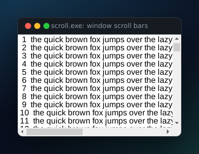 |
| **Common controls**: tool bar, tab control, a report-view **list view** with icons and check boxes, status bar:<br> | The **tree view** with buttons, lines and images:<br>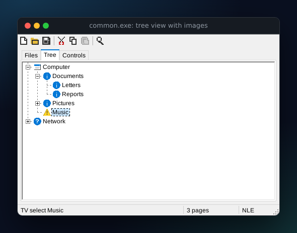 |
| **Progress, track and spin controls:**<br>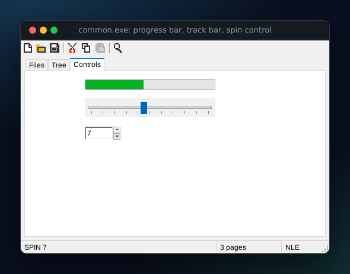 | |

## Try it

The programs in [`examples/`](examples) are built with MinGW-w64 (`apt install gcc-mingw-w64-x86-64`):

```console
$ examples/build.sh                    # the examples, built into examples/bin
$ nle examples/bin/sysinfo.exe         # system facts, registry, files, threads
$ nle relink examples/bin/sysinfo.exe -o dist && ./dist/sysinfo
$ nle examples/bin/controls.exe        # a form with windows (needs an X11 display)
$ nle examples/bin/paint.exe           # drag to draw, 1-4 colours, C clears
$ nle examples/bin/msgbox.exe          # message boxes; the answer is the exit code
$ nle examples/bin/common.exe          # tool bar, tabs, list view, tree view, status bar, spin control
```

Windows work through the display NLE finds in `DISPLAY`. For tests and CI there is a scripted headless display:
`NLE_GUI=headless NLE_GUI_SCRIPT="wait 200; click 130 25; type Ada; snapshot out.png; close" nle examples/bin/controls.exe`.
All of it is described in [docs/GUI.md](docs/GUI.md).

## Install

```console
$ git clone https://github.com/SegMind25/NLE && cd NLE
$ ./install.sh                         # builds in release mode, installs to ~/.local
$ nle doctor                        # checks that this machine can run native programs
```

Requirements: Linux on x86-64 (any distribution, kernel 4.x or newer), a Rust toolchain 1.88 or newer to build.

`install.sh` puts `nle` in `~/.local/bin` and `libnle.so` in `~/.local/lib/nle`. Set `PREFIX=/usr/local` (as
root) for a system-wide install.

## Commands

| command | what it does |
| --- | --- |
| `nle app.exe [args]` / `nle run app.exe [args]` | run a program; its exit code is yours |
| `nle inspect [--json] [-v] app.exe` | report format, imports per library, missing functions, verdict |
| `nle relink app.exe [-o DIR] [--name NAME] [--keep-original] [--strict]` | write a standalone native ELF (plus `libnle.so` and the program's DLLs) |
| `nle coverage [--markdown \| --json] [LIB]` | list the Windows functions that are implemented |
| `nle doctor` | check address space, segment selectors, `/proc`, optional pieces |
| `nle binfmt install \| remove \| status` | register `.exe` files with the kernel, so `./app.exe` just runs |

Run options: `--backend auto\|native\|wine`, `--prefix DIR`, `--strict`, `-v`.

### The Windows environment

* `C:\` is a directory (`~/.local/share/nle/prefix/drive_c`, or `$NLE_PREFIX/drive_c`); `Z:\` is the Linux root.
  File names match case-insensitively, as on Windows.
* The program sees its own Windows-style environment (`SystemRoot`, `TEMP`, `USERPROFILE`, ...) with your host variables added.
* The program believes it runs on Windows 10 (x64), in the "en-US" locale, with UTF-8 as the code page.
* `NLE_TRACE=load,bind,api` (or `all`) logs what the loader and the API layer do.
* `NLE_GUI=x11|headless` chooses the display for programs with windows (default: the X11 display in `DISPLAY`); `NLE_GUI_SCRIPT` drives the headless one, `NLE_FONT_DIR` adds a font directory.

### Relinked programs

`nle relink` writes an ELF file whose segments are the program's own sections at their original addresses. The kernel
maps them, the dynamic linker brings in `libnle.so`, and the runtime adopts the image that is already in memory. The
result runs without `nle` installed; keep `libnle.so` next to it (or pass `--rpath`). The original `.exe` is not
needed. Programs that start their own `.exe` again, such as multi-process programs, keep working because that path opens
the ELF.

## How it works

1. **Parse** the PE file (bounds-checked; fuzzed in the unit tests).
2. **Map** its sections at the preferred base address (or relocate), set up thread state where Windows code looks for it
   (`gs:[0x30]` = TEB, then PEB, TLS slots, the exception chain).
3. **Bind** every import to a Rust function declared `extern "win64"`, so the program calls straight into the runtime
   with the Windows x64 calling convention.
4. **Jump** to the entry point. Exceptions raised by the program, and faults raised by the CPU, are turned into Windows
   structured exceptions, unwound using the program's own `.pdata` tables.

More detail in [docs/ARCHITECTURE.md](docs/ARCHITECTURE.md). The list of implemented functions is in
[docs/COVERAGE.md](docs/COVERAGE.md) (generated by `nle coverage --markdown`).

## Build and test

```console
$ cargo build --release                # target/release/nle and target/release/libnle.so
$ cargo test --release                 # unit tests + real programs, see below
```

The integration tests compile the programs in `tests/exe` (C and C++) with MinGW-w64, and `tests/lang` (Go and Rust) when
those toolchains are present, then run each one twice: through `nle run` and as a relinked ELF. Without MinGW the
program tests print a notice and pass; install `gcc-mingw-w64-x86-64` and `g++-mingw-w64-x86-64` to run them for real.

## Project layout

```
src/            the library (loader, runtime, shims, relinker) and the CLI
examples/       small Windows programs to try NLE with
assets/         the logo (SVG and PNG) and the social preview image
tools/          regenerates the screenshots and logo PNGs
tests/exe/      Windows test programs in C / C++ (each prints ALL OK or one line per failed check)
tests/lang/     Go and Rust test programs
docs/           architecture, usage notes, coverage list
docs/replica/   the recon / architecture / parity records produced while building this
```

## License

MIT, see [LICENSE](LICENSE). Windows is a trademark of Microsoft; this project is not affiliated with or endorsed by
Microsoft, and it contains no Microsoft code.
