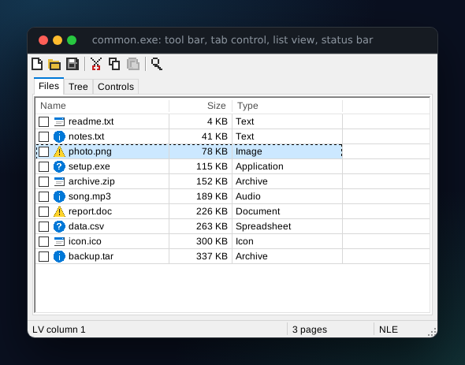

# Programs with windows

NLE runs Win32 programs that open windows: it implements the window manager, the message loop, GDI drawing
and the basic controls itself, and puts the finished pixels on an X11 display. Nothing of Wine is involved.



## Running one

```console
$ nle examples/bin/controls.exe          # needs an X11 display (DISPLAY is set on a normal desktop)
$ NLE_GUI=headless nle controls.exe      # no display: windows exist only in memory (see "Scripting")
$ nle doctor                             # shows whether a display and fonts were found
```

Wayland desktops work through XWayland, which provides `DISPLAY`. Without a display a program that creates a window
stops with an explanation (exit code 70) instead of hanging in its message loop; a `MessageBox` from a console
program prints its text to stderr and answers with the default button.

`nle inspect` tells you up front: a program that opens windows gets the note *"opens windows: needs an X11 display"*.

## What is supported

| area | supported |
| --- | --- |
| windows | window classes (`RegisterClass[Ex]`), top-level and child windows, styles, `WS_EX_*` frames, `CW_USEDEFAULT`, owner / parent, z-order, show / hide / maximize / restore, move and size, `GetWindowLongPtr` and `SetWindowLongPtr`, subclassing with `CallWindowProc`, window properties |
| messages | `GetMessage`, `PeekMessage`, `PostMessage`, `SendMessage` (also across threads), `PostQuitMessage`, `DefWindowProc`, `SetTimer` with and without a callback, `WM_PAINT` / `WM_ERASEBKGND` / `WM_SIZE` / `WM_CLOSE` / `WM_DESTROY`, keyboard (`WM_KEYDOWN`, `WM_CHAR`, `WM_SYSKEYDOWN`, ...), mouse (move, buttons, double clicks, wheel, capture), focus and activation, `WM_CONTEXTMENU`, `WM_SETCURSOR` |
| painting | `BeginPaint` / `EndPaint`, `GetDC` / `ReleaseDC`, `InvalidateRect`, `UpdateWindow`, `RedrawWindow`, clipping with rectangles and simple regions |
| GDI | pens, brushes (solid, hatch, pattern), TrueType fonts through `CreateFont*` (Arial, Times, Courier and friends map to Liberation / DejaVu), `TextOut`, `ExtTextOut`, `DrawText`, text metrics, lines, rectangles, round rectangles, ellipses, arcs, pies, polygons, polylines, Beziers, `FillRect`, `FrameRect`, `DrawEdge`, pixels, `PatBlt`, `BitBlt`, `StretchBlt`, `StretchDIBits`, `SetDIBitsToDevice`, memory DCs, `CreateCompatibleBitmap`, `CreateDIBSection` (24 and 32 bits), `GetDIBits`, `SaveDC` / `RestoreDC`, ROP2 modes, `AlphaBlend` (constant alpha), `TransparentBlt` |
| controls | `BUTTON` (push, default, check, 3-state, radio, group box, owner-draw), `STATIC` (text, frames, rectangles, lines, icons, bitmaps), `EDIT` (single-line and multi-line without word wrap, password, read-only, selection, copy and paste, `EM_*` messages, `EN_CHANGE`), `SCROLLBAR`, `LISTBOX` (single, multiple and extended selection, sorting, owner draw, type-ahead), `COMBOBOX` (simple, drop-down, drop-down list) |
| scroll bars | window scroll bars (`WS_VSCROLL` / `WS_HSCROLL`, `SetScrollInfo`, `ScrollWindow`) with thumb dragging, paging and auto-repeat |
| menus | menu bars, pop-up and sub menus, check and radio items, `TrackPopupMenu`, mnemonics (`Alt+letter`, `F10`), accelerator tables (`TranslateAccelerator`), menus from `.rc` resources |
| dialogs | `MessageBox` (all button sets, icons, default button, keyboard), `DialogBox` / `CreateDialog` from `.rc` templates (`DLGTEMPLATE` and `DLGTEMPLATEEX`), `IsDialogMessage` navigation (Tab, arrows, Enter, Esc, mnemonics), `EndDialog`, the `Get/SetDlgItem*` family |
| resources | the resource tree of the program and of loaded DLLs: `FindResource`, `LoadResource`, `LoadString`, `LoadIcon`, `LoadBitmap`, `LoadImage` (also from `.ico` and `.bmp` files), the built-in `IDI_*` icons |
| common controls | `comctl32`: progress, track and spin controls, status bar, tool bar (standard images included), tab control, list view (report, icon, small icon and list views, check boxes, virtual lists, column resizing, sorting), tree view (buttons, lines, images, check boxes, sorting), image lists, tool tips, window subclassing (`SetWindowSubclass`), `TaskDialog` |
| other | clipboard text (shared between the windows of one program, not with other applications), cursors, window properties (`SetProp`), `GetSystemMetrics`, `SystemParametersInfo`, monitors, `GetKeyState`, `GetCursorPos` |

Text is rendered with the system's TrueType fonts (Liberation, DejaVu, Noto, ...); `NLE_FONT_DIR` adds a directory.
Without any font, text shows as boxes and `nle doctor` says so.

## What is not supported (yet)

Programs that need these are reported as *partial* by `nle inspect`, and stop with the name of the missing function
when they call one:

* **Direct3D, OpenGL, DirectDraw, GDI+**, printing, and DPI scaling (windows are always 96 dpi).
* **Rich edit**, MDI windows, the common dialogs (`GetOpenFileName`, `ChooseColor`, ...), drag and drop, and ActiveX / OLE.
* Visual styles: controls look like the modern classic style, and do not follow a program's theme manifest.
* Custom draw notifications (`NM_CUSTOMDRAW`), label editing in list and tree views, and tool tips on hover.
* Per-pixel alpha and rotated text in GDI.
* Input methods: text entry is what the X keyboard layout produces.

## Scripting: the headless display

`NLE_GUI=headless` replaces the X server with an in-memory display that a script drives. It exists for tests and
screenshots, and it makes GUI programs usable in CI without any display:

```console
$ NLE_GUI=headless \
  NLE_GUI_SCRIPT="wait 200; click 130 25; type Ada; click 340 26; snapshot out.png; close" \
  nle controls.exe
```

Steps are separated by `;` or newlines and run one at a time, each when the program is idle, so every step sees
the result of the one before:

| step | does |
| --- | --- |
| `wait MS` | pause |
| `click X Y [left\|right\|middle]`, `dblclick X Y` | mouse click (client coordinates of the newest window) |
| `move X Y`, `down X Y [button]`, `up X Y [button]` | move, press, release |
| `smove X Y`, `sclick X Y`, `sdblclick X Y`, `sdown X Y`, `sup X Y` | the same with screen coordinates, which also reach pop-up menus and drop-down lists |
| `wheel DELTA` | mouse wheel (120 = one notch up) |
| `key [ctrl+\|shift+\|alt+]NAME` | a key: `a`, `5`, `enter`, `esc`, `tab`, `space`, `backspace`, `delete`, arrows, `home`, `end`, `pageup`, `pagedown`, `f1`..`f12` |
| `type TEXT` | type characters |
| `resize W H` | resize the window |
| `snapshot FILE.png` | save the window contents |
| `close` | press the close button |
| `exit [CODE]`, `print TEXT` | end the program; print a line |

`NLE_GUI_SCREEN=WxH` sets the size of the fake screen (default 1280x800).

## How it works

The window system lives in `src/gui/`:

* `surface.rs` and `font.rs` draw pixels into memory: lines, shapes, text with antialiasing, blits with raster
  operations. Every top-level window owns a BGRA surface; child windows and controls draw into their parent's.
* `gdi.rs` is the GDI object model: device contexts with their selected objects and state, drawing on top of the
  surfaces.
* `wm.rs` is the window tree: classes, geometry, invalidation, hit testing. `msg.rs` is the message pump and the
  default window procedure. `api.rs` holds the operations that send messages (create, destroy, show, paint).
* `controls.rs`, `ctl_list.rs` (list box, scroll bar), `ctl_combo.rs`, `ctl_basic.rs` (progress, track, spin, status,
  tool tips), `ctl_tab.rs`, `ctl_listview.rs`, `ctl_treeview.rs`, `ctl_toolbar.rs` and `msgbox.rs` are the built-in
  classes and `MessageBox`, written as ordinary window procedures registered like any program's own, so subclassing
  and `SendMessage` to them behave as on Windows. `menu.rs` and `dialog.rs` hold menus and dialog boxes, `nc.rs` and
  `scroll.rs` the non-client area and scroll bars, `res.rs` the resource tree, `imagelist.rs` image lists and
  `stock_icons.rs` the built-in icons.
* `x11.rs` loads libX11 at run time and shows surfaces with `XPutImage`; keyboard and mouse events come back
  through it. `headless.rs` is the scripted display.

One lock guards the whole window system, and it is never held while guest code runs or while waiting for input.
Window procedures run on the thread that owns the window, called directly, so a program's own `SEH` frames and
`SendMessage` re-entrancy work normally. The unit tests exercise each layer; `tests/gui.rs` runs real example
programs on the headless display and on Xvfb with real X events (`tests/gui/xdrive.c` plays the user).
