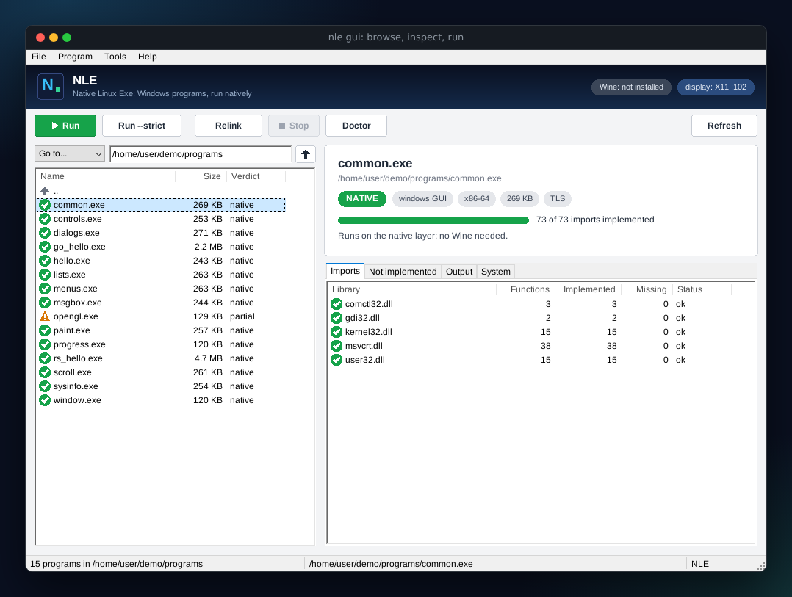

# The launcher: `nle gui`



`nle gui` is a desktop window for NLE itself. It is written in Rust on NLE's own window system, the one that runs
Windows programs ([GUI.md](GUI.md)), so it needs nothing more than they do: an X11 display (or the scripted headless
display, for tests).

```console
$ nle gui                      # starts in the current folder
$ nle gui ~/Downloads          # starts in a folder
$ nle gui ~/Downloads/app.exe  # starts in its folder with the program selected
```

`./install.sh` also puts NLE in the application menu and makes it a handler for `.exe` files, so a double-click in a
file manager opens the launcher on that program.

## What it does

* **Browse.** The left list shows folders and `.exe` files. Each program carries its verdict as an icon and a word:
  *native* (green tick), *partial* (amber triangle) or *unsupported* (red cross). The path box takes any folder
  (press Enter), *Go to...* jumps to home, Downloads, Desktop, the Windows `C:` drive of the prefix, or the current folder.
* **Inspect.** Selecting a program fills the card at the top right: verdict, subsystem (window or console), CPU, size,
  how many of its imports NLE implements, and which backend would run it (the native layer, or Wine when the program needs
  something NLE lacks and Wine is installed). The tabs list the imports per library, every function that is *not
  implemented*, and the output of what you run.
* **Run.** *Run* starts `nle run` on the program and shows what it prints in the *Output* tab; windows it opens appear as
  windows of their own. *Run --strict* refuses to start a program with missing imports. *Stop* ends the program.
* **Relink.** *Relink* writes a standalone native Linux ELF next to the program (`<name>-linux/`, with `libnle.so`), the
  same as `nle relink`.
* **Doctor.** *Doctor* runs `nle doctor`; the *System* tab keeps the current state of the checks (display, fonts,
  `libnle.so`, Wine, `binfmt_misc`) with a tick or a warning for each.

## Keys

| key | does |
| --- | --- |
| `Enter`, double-click | open a folder; run a program |
| `Backspace`, `Alt+Up` | up one folder |
| `Ctrl+L` | go to the path box |
| `F5` | read the folder again |
| `Ctrl+R`, `Ctrl+Shift+R` | run, run with `--strict` |
| `Ctrl+E` | relink to a Linux ELF |
| `Ctrl+.` | stop the running program |
| `F9` | doctor |
| `Alt+F`, `Alt+P`, `Alt+T`, `Alt+H` | the menus |
| `Ctrl+Q` | quit |

## How it works

The window is `src/launcher.rs`. Its controls are the built-in ones: a list view for the folder, tab control, list views
for the imports, a list box for the output, a status bar, a menu bar with accelerators; the card and the buttons are drawn
by the program itself with the same software renderer (so they look the same on every display).

Programs are analysed in process (`analyze::analyze`, the same code as `nle inspect`). Running, relinking and the doctor
start `nle` again as a child process; its output is read on background threads and shown by a timer on the window's own
thread, so the window never blocks while a program runs. Closing the launcher stops a program it started.

## Testing it

The launcher is driven in the tests the same way the example programs are: `tests/gui.rs` runs it on the headless display
with a script and on Xvfb with real pointer events, and checks what it reports. `nle gui --log` prints one line per event
(`DIR`, `SELECT name verdict`, `RUN`, `OUT`, `EXIT`, `RELINK`) so a script can follow along:

```console
$ NLE_GUI=headless NLE_GUI_SCRIPT="wait 600; click 100 211; wait 300; snapshot out.png; close" nle gui --log examples/bin
DIR bin
SELECT common.exe native
```

Mouse positions in the script are relative to the window (menu bar included).
